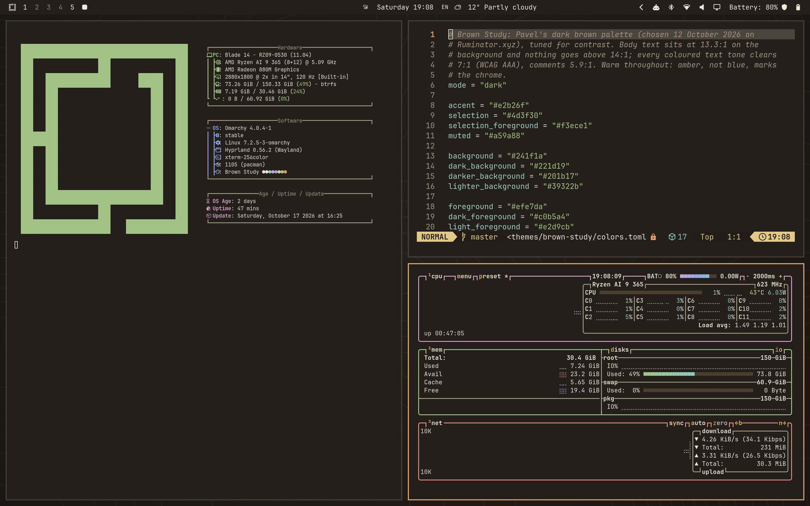
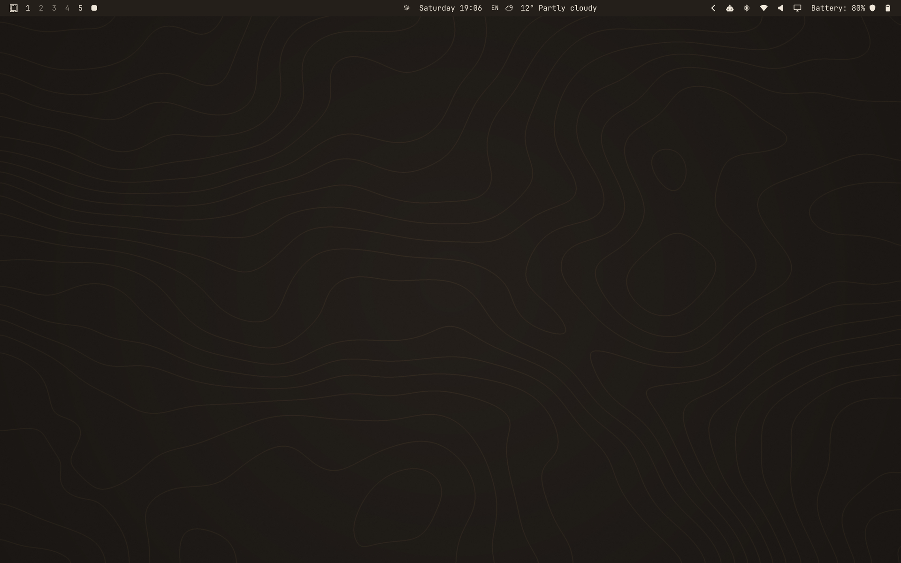

# Brown Study

A warm, dark brown theme for [Omarchy](https://omarchy.org/), made to be easy on the eyes and still sharp to read.



Most dark themes are near-black with near-white text. That contrast (often 18:1 or more) glares and tires the eyes over a long evening. Brown Study lifts the background to a warm brown and holds the text just below 14:1. Every colour you read in it still clears 7:1, the strictest accessibility level (WCAG AAA).

## Install

```bash
omarchy theme install https://github.com/xternal/omarchy-brown-study-theme
```

Then pick **Brown Study** from the theme menu, or:

```bash
omarchy theme set "Brown Study"
```

## What you get

- **One palette everywhere.** Omarchy builds the terminals, Hyprland borders, bar, menus, notifications, lock screen, Neovim, btop, Chromium, VS Code and Claude Code from `colors.toml`.
- **Amber, not blue.** The accent and the active window border are amber; blue only appears where it means something (links, syntax).
- **Brown icons.** Uses the Yaru-wartybrown icon set.
- **Three wallpapers.** Faint amber contour lines (the default), a warm lamplight glow, and plain brown. Cycle with `omarchy theme bg next`.



## The palette

| Role | Colour | Contrast on the background |
|---|---|---|
| Background | `#241f1a` | – |
| Raised surfaces | `#39322b` | – |
| Selection | `#4d3f30` | – |
| Text | `#efe7da` | 13.3:1 |
| Bright text | `#f3ece1` | 13.9:1 |
| Secondary text | `#c0b5a4` | 8.1:1 |
| Comments | `#a59a88` | 5.9:1 |
| Accent (amber) | `#e2b26f` | 8.4:1 |
| Red | `#ec9286` | 7.0:1 |
| Orange | `#eda070` | 7.7:1 |
| Yellow | `#ead08a` | 10.8:1 |
| Green | `#a8c98b` | 8.9:1 |
| Cyan | `#8fcfc4` | 9.3:1 |
| Blue | `#94acf0` | 7.3:1 |
| Magenta | `#dba6d4` | 8.1:1 |

Selected text sits at 8.7:1 on the selection colour, and dark text on the amber accent at 8.4:1.

## Why "Brown Study"

To be in a brown study is to be lost in thought. The palette began on [Ruminator](https://ruminator.xyz), a site about chewing things over, and it stayed for the long evenings.

## Licence

MIT. Made by [Pavel Guzhikov](https://guzh.uk) · [Buy me a coffee](https://ko-fi.com/pavelg)
